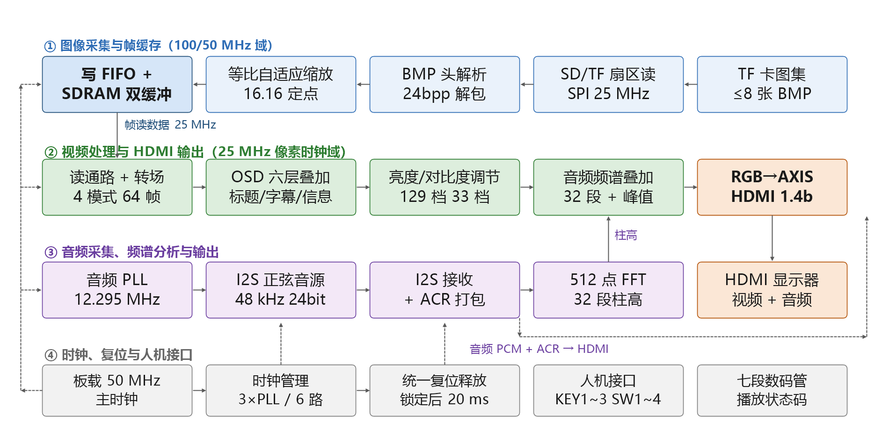
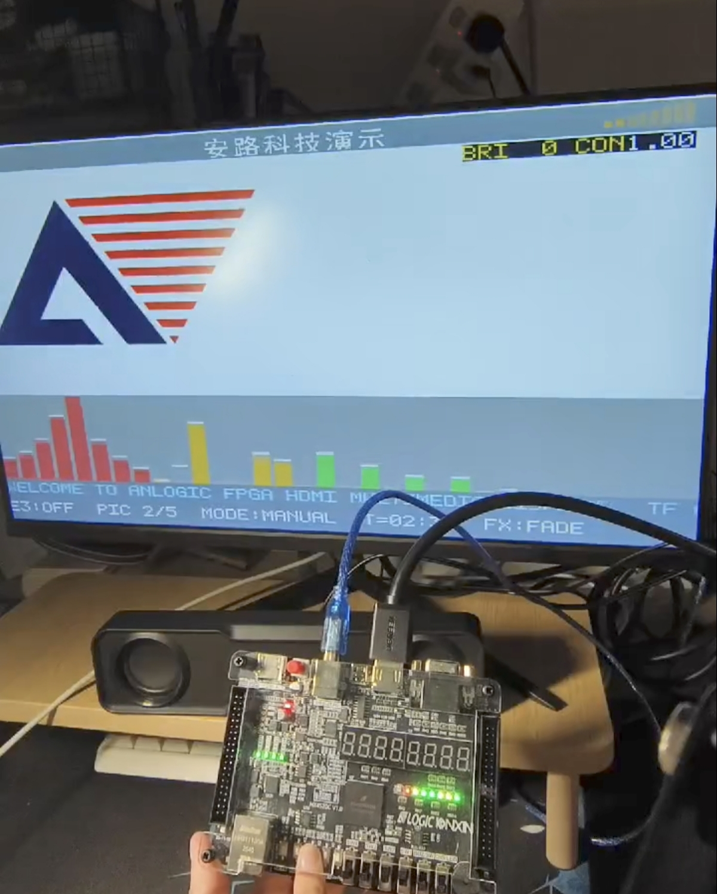
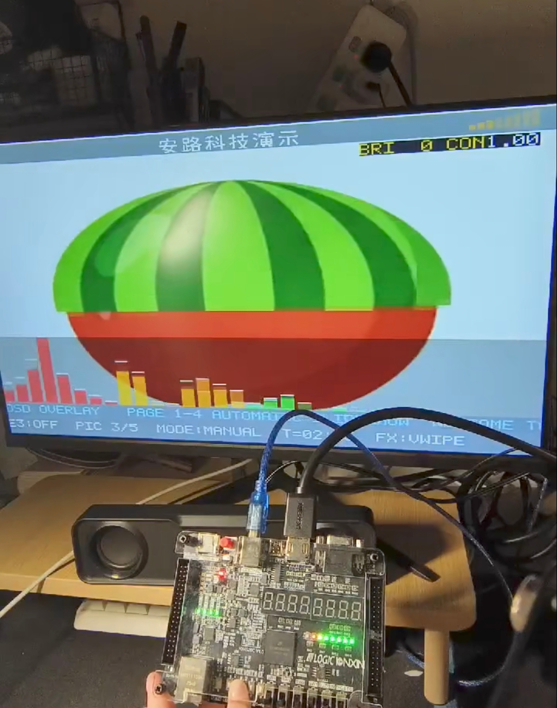

# 基于安路 FPGA 的 HDMI 多媒体播放系统

2026 年 FPGA 创新设计竞赛安路赛道选题一工程，使用 HX4S20C 开发板、EG4S20BG256 FPGA 和 Verilog HDL，实现 TF 卡 BMP 图像读取、SDRAM 帧缓存、HDMI 音视频输出及交互显示。

## 功能

- TF 卡图像读取、BMP 解析与 HDMI 显示。
- E1：OSD 图层、动态字幕与状态信息叠加。
- E2：多模式图片转场与轮播控制。
- E3：不同分辨率 BMP 图像的自适应缩放。
- E4：按键调节亮度、对比度及参数显示。
- E5：512 点 FFT 音频频谱可视化。
- 当前集成音源为内部 I2S 音阶发生器，经 HDMI 输出；不将其描述为已实现任意 TF 卡音乐文件解码。

## 系统架构与实物

架构图和照片来自本项目技术文档配图，展示系统结构与运行效果。具体端口、时钟及参数以本仓库 RTL、IP 配置和约束文件为准。

## 版本

本次发布取自已确认成功烧录、正常运行的 `E3_最终提交.rar` 版本：`95bde78a7889cfcbcd258a186c1bec0d67973ced` 加低水位判断表达式的单行修改，详见 [修改补丁](evidence/authorized_change.patch)。不混入后续首次启动模式修复候选版。

最终固件：[E3_95bde78_lowwater_bypass_TD621_20261101.bit](bit/E3_95bde78_lowwater_bypass_TD621_20261101.bit)，629624 字节。

SHA-256：`737d2c3a9ba63fa15449b9256afa27b9fd83f5d223469bae72cd3c4ef31dc7d0`。

## 打开工程

1. 使用 Windows 与 Anlogic TD 6.2.1 SP1，历史构建内部版本 `6.2.178840`。
2. 在 TD 中打开 `source/src/td_project/lab_ex5_i2s_v1.0.al`。
3. 目标器件 `EG4S20BG256`，顶层模块 `top`，板载输入时钟 50 MHz。
4. 保持 `td_project` 与 `user_source` 的相对目录。若 TD 要求重定位，选择当前下载副本中的 `td_project`。

工程、IP 配置、RTL 和约束完整保留。上传副本只清理生成器注释中的个人路径、工程根目录属性和固件生成脚本的旧路径，没有修改功能逻辑。详见 [发布整理说明](docs/PACKAGING.md)。本次整理未重新执行 TD 编译、仿真或烧录，亦未验证 TD 的迁移打开行为。

## 构建与仿真

历史成功流程及迁移要求见 [构建说明](docs/BUILD.md)。不要把通用 `run_build.py` 默认入口直接当作该成功流程的等价入口。

`source/tests/` 保留原提交中的测试代码、运行脚本和支持文件；`directed_check/tb_lowwater.sv` 为低水位表达式修改的定向检查。历史测试环境为 ModelSim SE-64 2020.4 和 TD `sim_release/eg4` 库，运行前需配置本机工具路径。OSD 测试字体 HEX 由 `run_osd_tests.py` 生成，产品字体及 FFT 表保存在 RTL 中。

`evidence/` 保留历史综合、STA 与最终版本核验记录，仅作为历史证据，不表示本次重新跑过相应验证。

## 操作入口

顶层端口注释定义：KEY1 手动下一张、KEY2 切换自动播放、KEY3 参数调节；SW1/SW2 选择转场模式，SW3 选择亮度或对比度，SW4 控制 E3 自适应模式。板级连接以 `pin.adc`、`pin_e3.adc` 和实际板卡丝印为准。

## 文件目录

| 目录或文件 | 内容 |
| --- | --- |
| `source/src/` | Verilog/VHDL、安路 IP、TD 工程和约束 |
| `source/scripts/` | 构建、时序审计和测试脚本 |
| `source/tests/` | 仿真用例与支持模型 |
| `directed_check/` | 低水位修改定向检查 |
| `bit/` | 已确认版本的最终固件 |
| `docs/` | 架构图、实物照片与构建/整理说明 |
| `evidence/` | 精选版本与历史验收记录 |
| `FILES_SHA256.json` | 本次发布文件长度和 SHA-256 |
| `UPLOAD_FILE_LIST.md` | 完整上传清单 |

## 第三方组件

工程包含安路官方 IP 和参考模块，保留原有版权声明；本仓库未对这些组件另行授予开源许可。详见 [第三方组件说明](THIRD_PARTY_NOTICES.md)。
